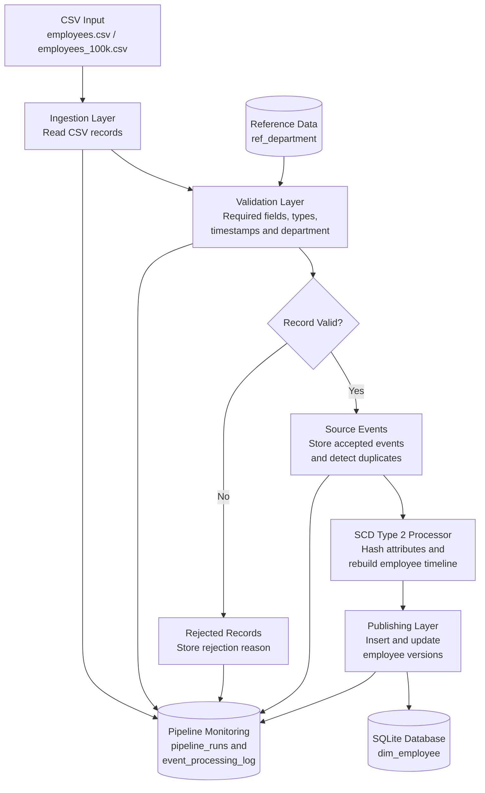

# Historical Employee Data Pipeline – Architecture

## 1. Architecture Overview

The pipeline processes employee events from CSV input, validates records, stores accepted events, builds historical employee timelines, and publishes SCD Type 2 records into SQLite.

## 2. Architecture Diagram

## 3. Component Responsibilities

| Component | Responsibility |
|---|---|
| CSV Input | Provides employee event records |
| Ingestion | Reads CSV records and identifies source rows |
| Validation | Checks required fields, data types and business rules |
| Reference Data | Provides valid department codes |
| Source Events | Maintains accepted source events |
| SCD2 Processor | Detects attribute changes and builds historical timelines |
| Publishing | Publishes employee historical versions |
| SQLite | Stores employee history and pipeline data |
| Monitoring | Tracks execution status and event processing activity |
| Rejection Handling | Stores invalid or conflicting records |

## 4. Processing Flow

1. Employee events are provided through a CSV file.
2. The ingestion module reads the records.
3. The validation module checks each record.
4. Invalid records are recorded in `rejected_records`.
5. Valid events are stored in `source_events`.
6. The SCD Type 2 processor rebuilds the affected employee timeline.
7. The publishing layer updates `dim_employee`.
8. Pipeline execution and event processing details are maintained for monitoring and recovery.

## 5. Architecture Benefits

- Separation of ingestion, validation, processing and publishing.
- Historical employee tracking.
- Duplicate and conflicting event handling.
- Support for late-arriving events.
- Traceable pipeline executions.
- Safe recovery and repeat processing.